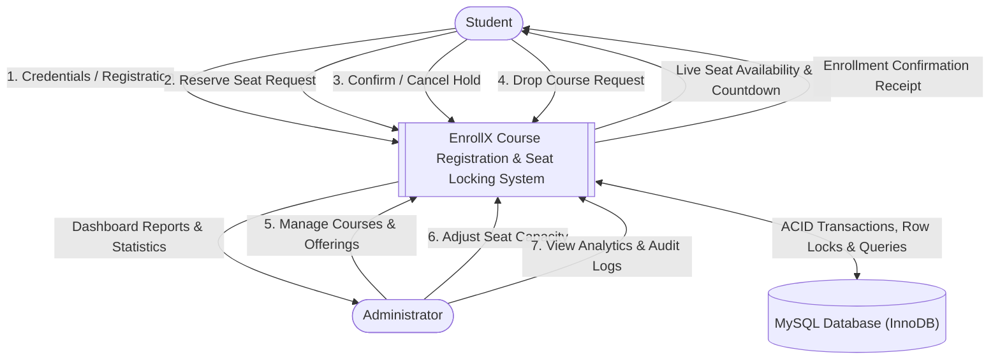
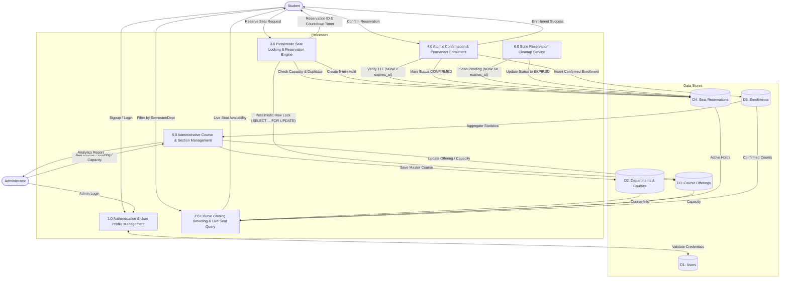

# EnrollX — Data Flow Diagrams (DFD)

## 1. DFD Level 0 (Context Diagram)

The Level 0 Context Diagram depicts the entire EnrollX system as a single central process interacting with external entities (Student, Administrator, and MySQL Database Engine).

---

## 2. DFD Level 1 (Detailed Subsystem Decomposition)

The Level 1 DFD decomposes the system into six core functional sub-processes and data stores.

