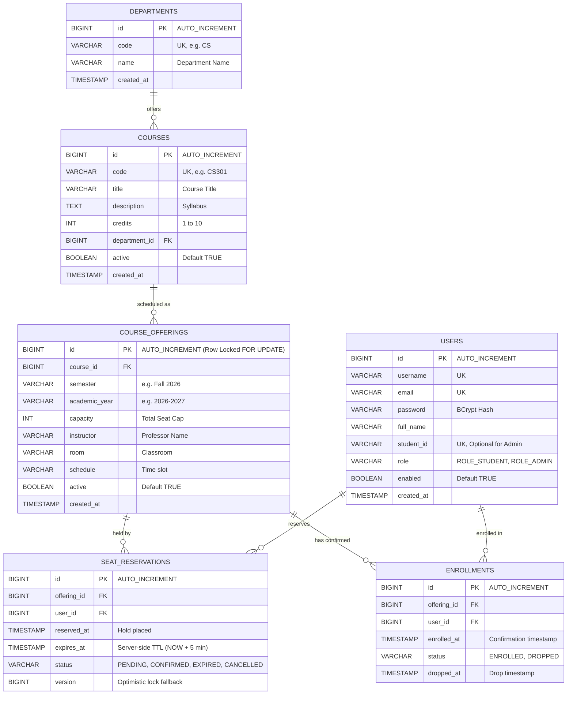

# EnrollX — Entity-Relationship (ER) Diagram & Schema Documentation

## 1. Mermaid Entity-Relationship Diagram

---

## 2. Relationships and Cardinalities

### 1. `DEPARTMENTS` to `COURSES` (1 : M)
- **Cardinality:** One department can offer zero, one, or many courses (`1 to M`). Each course must belong to exactly one academic department (`M to 1`).
- **Foreign Key:** `courses.department_id` references `departments.id`.
- **Constraint:** `ON DELETE RESTRICT` (Prevents accidental deletion of a department if courses are attached to it).

### 2. `COURSES` to `COURSE_OFFERINGS` (1 : M)
- **Cardinality:** A master course definition can have multiple offerings across semesters (e.g., CS101 offered in Fall 2026 and Spring 2027). Each offering belongs to exactly one master course.
- **Foreign Key:** `course_offerings.course_id` references `courses.id`.
- **Unique Constraint:** `(course_id, semester, academic_year)` guarantees that the university cannot inadvertently create duplicate offering records for the same course in the same semester.

### 3. `COURSE_OFFERINGS` to `SEAT_RESERVATIONS` (1 : M)
- **Cardinality:** A course offering can have multiple seat reservations over time. Each reservation corresponds to a single course offering.
- **Foreign Key:** `seat_reservations.offering_id` references `course_offerings.id`.

### 4. `USERS` to `SEAT_RESERVATIONS` (1 : M)
- **Cardinality:** A student can create multiple reservations over their academic career. Each reservation is owned by one student user.
- **Foreign Key:** `seat_reservations.user_id` references `users.id`.

### 5. `COURSE_OFFERINGS` and `USERS` to `ENROLLMENTS` (M : N resolved)
- **Cardinality:** A student can enroll in multiple course offerings, and a course offering can enroll multiple students. This represents a classic Many-to-Many ($M:N$) relationship.
- **Associative Entity:** The relationship is resolved through the junction table `enrollments`.
- **Unique Constraint:** `(offering_id, user_id)` guarantees at the database engine level that no student can be registered more than once for the same section.

---

## 3. Storage Engine & Indexing Justification
- **Storage Engine:** All tables are explicitly defined with `ENGINE=InnoDB`. InnoDB is mandatory because MySQL's default storage engine supports row-level locking, foreign key integrity constraints, and two-phase commits for ACID transactions.
- **B+ Tree Indexes:**
  - `idx_res_offering_status_expires (offering_id, status, expires_at)`: This composite index makes the real-time seat availability query execute in $O(\log N)$ time, scanning only pending unexpired rows.
  - `idx_enrollments_offering (offering_id)`: Speeds up confirmed enrollment counts.
  - `idx_users_role (role)`: Speeds up administrative filtering.
